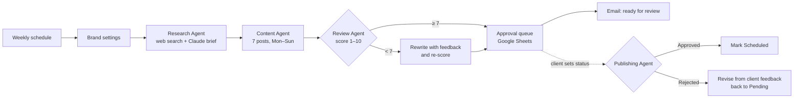
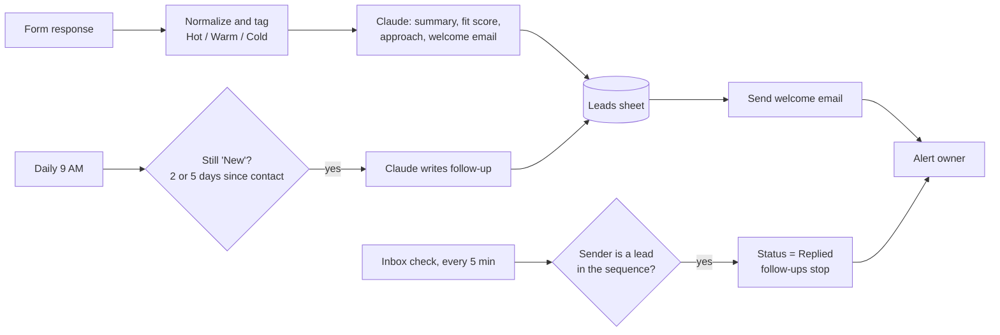
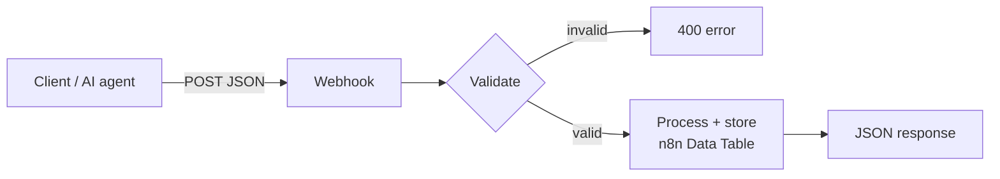

# n8n Automation Portfolio — Kenneth Garcia

AI automation projects I designed and built in **n8n**. They connect business tools, LLMs (Claude) and webhooks into end-to-end systems.

This page describes how each system works. The workflow files are kept private; I'm happy to walk through them live or share them on request.

🌐 **Website:** [kennethgarcia.vercel.app](https://kennethgarcia.vercel.app/)

---

## Skills shown

| Area | Used in these projects |
|---|---|
| **Workflow automation** | n8n: schedule, webhook, polling, chat and error triggers; sub-workflows; branching; merges |
| **AI / LLM integration** | Claude (Anthropic) agents with structured JSON output parsers; multi-agent orchestration; AI quality-review loops |
| **API integration** | Gmail, Google Sheets, Google Calendar (OAuth2), Brave Search API, custom JSON webhook APIs |
| **Data handling** | Upserts keyed on unique IDs, duplicate detection, data normalization, n8n Data Tables |
| **Reliability** | Central error-alert workflow, retries on external calls, continue-on-error for non-critical steps, human approval steps |
| **JavaScript** | Code nodes for data shaping and invoice calculation; n8n expressions |

---

## 1. Multi-Agent Social Media Automation

A team of AI agents researches, writes, reviews and queues a week of social media content for a small business. The client approves or rejects each post in a Google Sheet.

**7 workflows:** Orchestrator · Research Agent · Content Agent · Review Agent · Publishing Agent · Error Alerts · Setup

**How it works**
- **Orchestrator:** a main workflow calls three sub-workflows, so each agent can be tested and reused on its own.
- **Research Agent:** runs three live web searches (trends, competitors, industry news). Claude turns the results into a structured brief.
- **Review Agent quality loop:** each post is scored on hook, brand fit and clarity. Posts under 7/10 are rewritten using the reviewer's specific feedback, then scored again.
- **Human approval:** nothing is published automatically. The client approves or rejects posts in a shared sheet. Rejected posts are rewritten from the client's feedback and sent back for approval.
- **Error handling:** if any agent fails, an alert email is sent with the failed step and a link to the run.

---

## 2. AI Lead Nurturing System

Turns inquiry-form submissions into scored leads, sends personalized AI emails, follows up automatically, and stops when the lead replies.

**3 workflows:** New Lead → AI Welcome Email · AI Follow-up Sequence · Reply Detector

**How it works**
- **Lead scoring:** a rule-based Hot/Warm/Cold priority from budget and urgency, plus an AI fit score (1–10) with a written summary and a suggested technical approach.
- **Personalized emails:** Claude restates the lead's specific problem, suggests one concrete automation idea, and asks clarifying questions. Strict rules: no prices, no placeholders, under 170 words.
- **Follow-up sequence:** two follow-ups timed from the last contact, each with a different angle. The lead is then marked *Nurture Complete*.
- **Reply detection:** the inbox is checked every 5 minutes. When a lead replies, their follow-ups stop and the owner gets an alert.
- **Idempotent:** leads are upserted on a unique Lead ID, so re-runs never create duplicates.

---

## 3. Business Operations Webhook APIs

Three JSON REST endpoints that other systems or AI agents can call. Each validates its input and returns a proper HTTP status code.

| Endpoint | Input | What it does | Responses |
|---|---|---|---|
| **Add Lead to CRM** | `full_name`, `email`, `company`, … | Normalizes the input, checks for an existing lead by email, then inserts | `201` created · `200` duplicate |
| **Check Inventory** | `product` (name or SKU, partial match) | Searches stock and flags *Low stock* or *Out of stock* against reorder levels | `200` with matches |
| **Send Invoice** | client details and line items | Calculates line totals, 12% VAT and due date; saves the invoice; returns a ready-to-send email | `201` issued · `400` invalid |

---

## 4. AI Calendar Assistant

A chat-based AI agent with conversation memory that can **check** and **create** Google Calendar events using natural language, for example "What's on my schedule today?" or "Book a call tomorrow at 3 PM."

---

## Contact

Want a walkthrough or the workflow files? Get in touch through my website: **[kennethgarcia.vercel.app](https://kennethgarcia.vercel.app/)**
